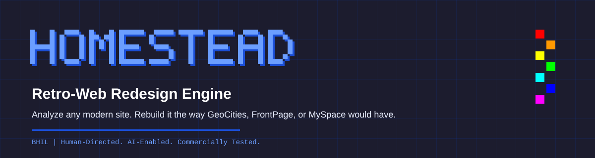
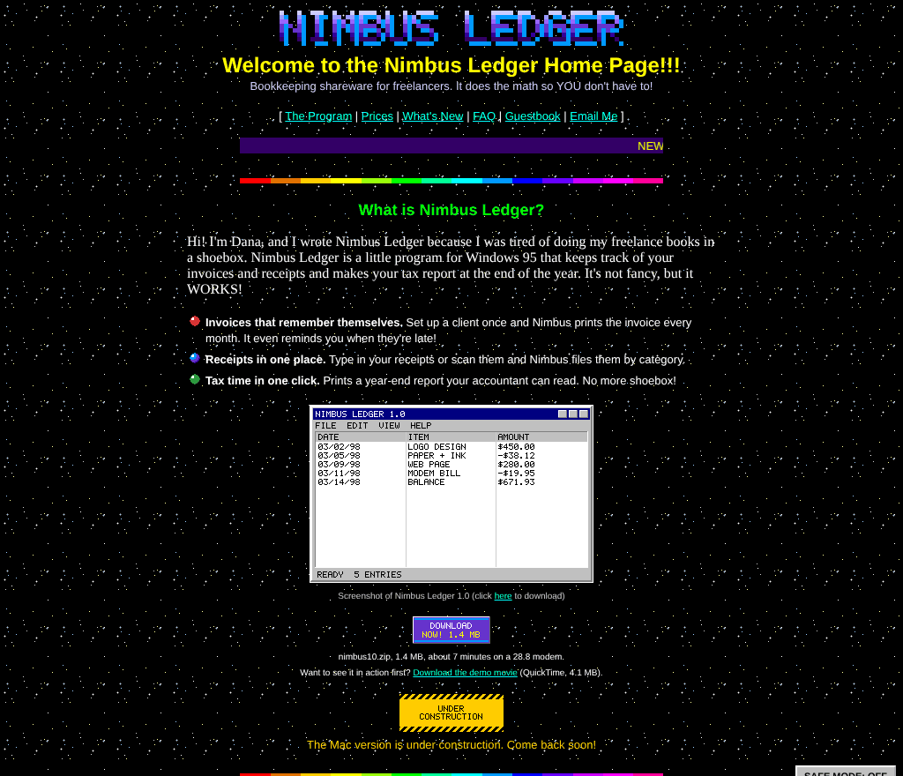
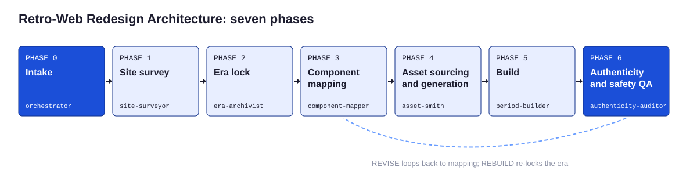

# BHIL-HOMESTEAD



**Analyze any modern website and rebuild it the way GeoCities, FrontPage, or MySpace would have.**

HOMESTEAD is a repeatable process, a stdlib-only toolchain, and a Claude Code agent team for retro web redesigns. Point it at a modern site, lock one era, and it walks you from inventory to a period build that survives View Source, ships with a Safe Mode for today's visitors, and carries a 40-point authenticity score. Every image and sound is generated from scratch, so builds carry no borrowed GIFs, fonts, or songs.

REF HOMESTEAD-001 | v1.0.0 | Barry Hurd Intelligence Lab

| Modern source | Preset B, 1998 | Preset C, 2001 | Preset E, 2007 |
|---|---|---|---|
| [Nimbus Ledger, 2026](examples/nimbus-ledger/source/index.html) | [GeoCities homepage](examples/nimbus-ledger/builds/preset-b-1998/index.html) | [FrontPage company site](examples/nimbus-ledger/builds/preset-c-2001/index.html) | [Profile page](examples/nimbus-ledger/builds/preset-e-2007/index.html) |



## Highlights

- **Six locked era presets, not one retro look.** Proto-Web, GeoCities, FrontPage corporate, Web 1.5 portal, MySpace profile, and modern revival, each with a canvas width, palette, fonts, widgets, voice, and motion budget. Kits ship for the three best-documented eras. [Presets](docs/presets/README.md)
- **Component-by-component translation.** 24 modern patterns (hero, cards, pricing, testimonials, cookie banner, chat widget, analytics) each mapped to their period equivalent per era. [Mapping table](docs/reference/mapping-table.md)
- **An anachronism lint and a flash audit.** 28 lint rules catch web fonts, rounded corners, flexbox, emoji, era mixing, and missing safety wiring; the GIF audit checks frame timing and WCAG flash area. [QA](docs/08-authenticity-qa.md)
- **Safe Mode on every page.** One control stops every marquee, blink, animation, and sound and raises contrast; it starts on for reduced-motion visitors. [Safety](docs/09-accessibility-and-safety.md)
- **A blind auditor.** The agent that grades the build cannot write files and never sees the builder's notes. [Agents](docs/11-agent-architecture.md)

## Start here

| If you want to | Go to |
|---|---|
| See a result in five minutes | [Quickstart](support/quickstart.md) |
| Understand the method | [Overview](docs/01-overview.md), then [Process](docs/02-process.md) |
| Run it with Claude Code | `/homestead <url> recommend`, see [Agent architecture](docs/11-agent-architecture.md) |
| Run it in any chat tool | [P00 Command Center](prompts/P00-command-center.md) or the [portable skill](skill/README.md) |
| Pick an era | [Era lock](docs/04-era-lock.md) |
| Check the rights picture | [Legal and licensing](docs/10-legal-and-licensing.md) |
| Contribute | [CONTRIBUTING.md](CONTRIBUTING.md) |

## The pipeline



| Phase | Owner | Tool |
|---|---|---|
| 0 Intake | orchestrator | `tools/scaffold.py` |
| 1 Site survey | site-surveyor | `tools/survey.py` |
| 2 Era lock | era-archivist | era spec cards |
| 3 Component mapping | component-mapper | `tools/map.py` |
| 4 Assets | asset-smith | `tools/websafe.py`, `gifsmith.py`, `dither.py`, `chiptune.py` |
| 5 Build | period-builder | kits, safety layer, `tools/era_lint.py` |
| 6 Authenticity QA | authenticity-auditor | `tools/era_lint.py`, `gif_audit.py`, `rubric.py` |

## Quick commands

```bash
python3 tools/scaffold.py new acme --target https://acme.example --preset B
python3 tools/survey.py https://acme.example --pages 6 --out engagements/acme/01-inventory/inventory.json
python3 tools/map.py engagements/acme/01-inventory/inventory.json --spec engagements/acme/02-era-spec.json --out engagements/acme/03-mapping.md
python3 tools/era_lint.py engagements/acme/05-build --spec engagements/acme/02-era-spec.json
python3 tools/rubric.py score engagements/acme/06-qa/scorecard.json
```

Python 3.10 or newer, standard library only.

## Repository structure

```
BHIL-HOMESTEAD/
  canon/          single source of truth: presets, widgets, mapping, rubric, lint rules, claims
  tools/          stdlib engagement tools and the hs_core library (GIF codec, pixel font, PNG, audio)
  scripts/        derived-artifact generator, drift gate, validator, site assembler, lint hook
  kits/           preset B, C, and E starters plus the safety layer
  examples/       Nimbus Ledger taken through every phase into three eras
  prompts/        P00 to P10 prompt system
  .claude/        six subagents, seven slash commands, settings, hook wiring
  skill/          portable SKILL.md
  docs/           process docs, generated preset pages and reference tables
  support/        quickstart, FAQ, troubleshooting, glossary
  adr/            eight architecture decisions
  templates/      intake, era spec cards, asset log, scorecard, QA notes
  schemas/        inventory, era spec, scorecard
  assets/         generated SVG diagrams
  data/           CSV and JSON exports of canon
  launch/         GitHub descriptions and LinkedIn copy
  engagements/    your work (gitignored)
```

## Contents

| Area | Pages |
|---|---|
| Method | [Overview](docs/01-overview.md), [Process](docs/02-process.md), [Survey](docs/03-site-survey.md), [Era lock](docs/04-era-lock.md), [Mapping](docs/05-component-mapping.md), [Assets](docs/06-assets.md), [Build](docs/07-build.md), [QA](docs/08-authenticity-qa.md) |
| Safety and rights | [Accessibility and safety](docs/09-accessibility-and-safety.md), [Legal and licensing](docs/10-legal-and-licensing.md), [Safety layer](kits/safety-layer/README.md) |
| Agents and prompts | [Agent architecture](docs/11-agent-architecture.md), [Agent roster](docs/reference/agent-roster.md), [Prompts](prompts/README.md), [AGENTS.md](AGENTS.md) |
| Reference | [Presets](docs/presets/README.md), [Mapping table](docs/reference/mapping-table.md), [Widgets](docs/reference/widget-registry.md), [Rubric](docs/reference/rubric.md), [Lint rules](docs/reference/lint-rules.md), [Technical vocabulary](docs/reference/technical-vocabulary.md), [Fonts](docs/reference/font-map.md), [Web-safe palette](docs/reference/web-safe-palette.md), [Evidence register](docs/reference/evidence-register.md) |
| Kits | [Preset B](kits/preset-b-geocities/README.md), [Preset C](kits/preset-c-frontpage/README.md), [Preset E](kits/preset-e-myspace/README.md) |
| Decisions | [ADR index](adr/README.md) |
| Help | [Support](support/README.md) |

## Quality gates

```bash
python3 scripts/validate.py            # dash gate, canon integrity, counts, schemas, agent tools, builds, links
python3 scripts/verify_drift.py        # every derived artifact matches canon byte for byte
python3 -m unittest discover -s tests  # regression tests, each naming the bug it prevents
```

## Credits and license

Built by Barry Hurd Intelligence Lab. Research inputs are recorded with evidence tiers in the [evidence register](docs/reference/evidence-register.md), including Olia Lialina's writing on the vernacular web, the Internet Archive's GifCities, Restorativland, One Terabyte of Kilobyte Age, and prior art such as web98 and an existing FrontPage agent skill. Nimbus Ledger and every person, band, and network in the example are fictional.

Code and schemas: MIT ([LICENSE](LICENSE)). Documentation, prompts, kits, and generated assets: CC BY 4.0 ([LICENSE-CONTENT](LICENSE-CONTENT)). Not legal advice.

*Human-Directed. AI-Enabled. Commercially Tested.*
