<!-- Generated from canon/brand.json by scripts/figures.py. Do not edit by hand; edit canon and rebuild. -->

# Figure kit

Ten 1600 x 900 figures that put period web specimens (pixel type, bevels, 88x31 badges, odometers, marquees) inside the BHIL instrument frame from BHIL Brand Guidelines v1.0 (2026). Every figure is drawn from canon and the worked example's data by `scripts/figures.py`, written by `scripts/build_derived.py`, and drift-checked with the rest of the repository ([ADR-009](../../adr/ADR-009-figure-kit.md)).

Animations are CSS only, slow, and small in area. Frame zero is the designed static frame, and every animation stops when the viewer prefers reduced motion. A standalone [gallery](gallery.html) shows all ten.

## Files

| Form | Where | Use |
|---|---|---|
| Animated SVG | `assets/figures/hs-NN-*.svg` | README, docs site, anywhere an `` tag works. Falls back to Georgia, Arial, and Courier New where brand fonts cannot load |
| Static PNG, 1600 x 900 | `assets/figures/png/hs-NN-*.png` | Slides, documents, social posts. Rendered with the brand fonts |
| Gallery | `assets/figures/gallery.html` | Review all ten on one page |

Refresh the PNGs after any figure change with `python3 scripts/render_figures.py` (needs Playwright and Chrome). `scripts/validate.py` fails when a PNG is older than its SVG.

## Brand rules applied

- Terminal Navy canvas, BH Blue accents, hairlines not boxes, square corners, no drop shadows, no gradients on motifs.
- One BHIL motif per figure: the dot constellation only on HS-01, the ASCII pipeline only on HS-03, the prompt chevron in the eyebrow everywhere else.
- Retro specimens (pixel type, bevels, badges, counters, period colors) sit inside the BHIL frame as content, never as the frame.
- Every animation is CSS, slow, small in area, stops under prefers-reduced-motion, and frame zero is the designed static frame.
- No em dashes or en dashes; the repository dash gate scans every SVG.

## The figures

### HS-01: Retro-Web Redesign Engine

Motion: Stars in the dot constellation twinkle slowly; the dot-matrix cursor blinks once per second.

Placed in: [`README.md`](../../README.md), [`docs/01-overview.md`](../../docs/01-overview.md). PNG: [`png/hs-01-masthead.png`](png/hs-01-masthead.png).

### HS-02: Six neighborhoods. One address per build.

Motion: A highlight frame visits one era at a time, every two seconds.

Placed in: [`README.md`](../../README.md), [`docs/04-era-lock.md`](../../docs/04-era-lock.md), [`docs/presets/README.md`](../../docs/presets/README.md). PNG: [`png/hs-02-era-neighborhoods.png`](png/hs-02-era-neighborhoods.png).

### HS-03: Seven phases. Every one leaves paper.

Motion: A block cursor steps through the seven phases, two seconds each.

Placed in: [`README.md`](../../README.md), [`docs/01-overview.md`](../../docs/01-overview.md), [`docs/02-process.md`](../../docs/02-process.md), [`docs/reference/phase-map.md`](../../docs/reference/phase-map.md), [`prompts/README.md`](../../prompts/README.md). PNG: [`png/hs-03-pipeline.png`](png/hs-03-pipeline.png).

### HS-04: Inventory before era.

Motion: A scan line sweeps down the modern page every four seconds.

Placed in: [`docs/03-site-survey.md`](../../docs/03-site-survey.md). PNG: [`png/hs-04-site-survey.png`](png/hs-04-site-survey.png).

### HS-05: Translate component by component.

Motion: A highlight frame steps down the six rows.

Placed in: [`README.md`](../../README.md), [`docs/05-component-mapping.md`](../../docs/05-component-mapping.md), [`docs/reference/mapping-table.md`](../../docs/reference/mapping-table.md). PNG: [`png/hs-05-component-mapping.png`](png/hs-05-component-mapping.png).

### HS-06: Every glyph drawn here. Nothing borrowed.

Motion: The construction sign and glitter specimens play their real frames at 600 ms and 400 ms.

Placed in: [`docs/06-assets.md`](../../docs/06-assets.md), [`docs/reference/web-safe-palette.md`](../../docs/reference/web-safe-palette.md). PNG: [`png/hs-06-asset-smithy.png`](png/hs-06-asset-smithy.png).

### HS-07: View Source never lies.

Motion: Flagged lines pulse copper; the editor cursor blinks.

Placed in: [`docs/07-build.md`](../../docs/07-build.md), [`docs/reference/lint-rules.md`](../../docs/reference/lint-rules.md). PNG: [`png/hs-07-view-source.png`](png/hs-07-view-source.png).

### HS-08: Keep the chaos. Give it an off switch.

Motion: Only the as-built side moves: twinkling stars, a slow marquee, and a once-per-second NEW badge.

Placed in: [`README.md`](../../README.md), [`docs/09-accessibility-and-safety.md`](../../docs/09-accessibility-and-safety.md), [`kits/safety-layer/README.md`](../../kits/safety-layer/README.md). PNG: [`png/hs-08-safe-mode.png`](png/hs-08-safe-mode.png).

### HS-09: Graded blind. Scored to forty.

Motion: The SHIP stamp breathes slowly.

Placed in: [`README.md`](../../README.md), [`docs/08-authenticity-qa.md`](../../docs/08-authenticity-qa.md), [`docs/reference/rubric.md`](../../docs/reference/rubric.md), [`examples/nimbus-ledger/README.md`](../../examples/nimbus-ledger/README.md). PNG: [`png/hs-09-rubric.png`](png/hs-09-rubric.png).

### HS-10: The crew's Top 8. One of them can't write.

Motion: The orchestrator's ONLINE NOW badge blinks once per second.

Placed in: [`README.md`](../../README.md), [`docs/11-agent-architecture.md`](../../docs/11-agent-architecture.md), [`docs/reference/agent-roster.md`](../../docs/reference/agent-roster.md). PNG: [`png/hs-10-agent-crew.png`](png/hs-10-agent-crew.png).
