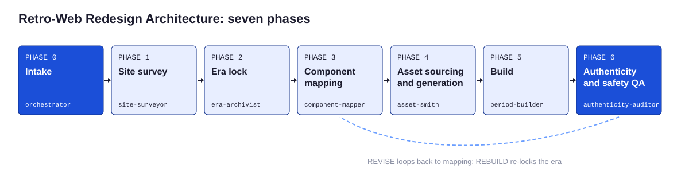

# Overview

HOMESTEAD is a repeatable way to take any modern website and rebuild it as if it had been made in an earlier era of the web: a GeoCities homepage in 1998, a FrontPage company site in 2001, a MySpace profile in 2007. It is a process, a set of stdlib-only tools, three working kits, an agent team, and a rubric that grades the result.

The name comes from GeoCities, whose members were called Homesteaders and whose pages lived in themed neighborhoods such as SiliconValley and Hollywood (STATED, [C-010](reference/evidence-register.md#c-010); CORROBORATED, [C-011](reference/evidence-register.md#c-011)).

## Why a process and not a style

Most retro redesigns fail in one of two ways. Some mix eras: glitter text from 2007 on a starry 1996 page, a MySpace Top 8 on a FrontPage corporate site. Others leak the present: web fonts, rounded corners, even gutters, responsive reflow, and copy that says get started. Both are easy to see and hard to unsee.

HOMESTEAD treats the old web as six dated presets with checkable specs, and treats the redesign as a translation where every modern component gets a decision. That makes the work repeatable by a person or by agents, and gradeable by someone who did not do it.

## The core principle

> A retro redesign is a translation, not a costume. Lock one era, inventory the modern site, map every component to its period equivalent, build in period markup, then let a separate auditor grade it.

## The parts

| Part | What it is | Where |
|---|---|---|
| Canon | Single source of truth: presets, widgets, mapping, rubric, lint rules, techniques, fonts, claims | `canon/` |
| Process | Seven phases from intake to audit | [02-process.md](02-process.md) |
| Presets | Six locked era specs, three with kits | [presets/](presets/README.md) |
| Tools | Survey, mapper, web-safe snapper, GIF and audio generators, dither, lint, GIF audit, rubric, scaffold | `tools/` |
| Kits | Working starters for presets B, C, and E | [kits/](../kits/preset-b-geocities/README.md) |
| Safety layer | Safe Mode, blink emulation, click-to-play audio | [kits/safety-layer](../kits/safety-layer/README.md) |
| Agent team | Orchestrator plus six tool-isolated subagents | [11-agent-architecture.md](11-agent-architecture.md) |
| Prompts | P00 to P10 for any chat tool | [prompts/](../prompts/README.md) |
| Rubric | 40-point scorecard with hard gates | [reference/rubric.md](reference/rubric.md) |
| Worked example | One fictional SaaS site rebuilt three ways | [examples/nimbus-ledger](../examples/nimbus-ledger/README.md) |

## What HOMESTEAD produces

For each engagement, a folder with:

- an intake record and rights decision,
- an inventory of the modern site,
- an era spec card,
- a decided mapping table and an era copy deck,
- an asset log and generated assets,
- period HTML pages with Safe Mode and a text-only version,
- a lint report, a GIF audit, and a scored rubric.

## Design commitments

- **Era fidelity is checkable.** Screen resolutions, the web-safe palette, FrontPage's components, and MySpace profile anatomy are documented, so presets carry hard specs (see the [evidence register](reference/evidence-register.md)).
- **Period markup, modern safety.** Pages are written the way they were written, with a two-file safety layer for what modern visitors need ([ADR-003](../adr/ADR-003-period-markup-with-safety-layer.md)).
- **Originals first.** Every asset is generated or commissioned new by default ([ADR-004](../adr/ADR-004-originals-first-assets.md)).
- **The work never grades itself.** The auditor cannot write and does not see the builder's notes ([ADR-005](../adr/ADR-005-blind-auditor.md)).
- **Nothing is ever called clean.** Lint and audits report findings or INCONCLUSIVE ([ADR-007](../adr/ADR-007-no-clean-verdicts.md)).

## Where to start

| You want to | Start with |
|---|---|
| Try it in five minutes | [support/quickstart.md](../support/quickstart.md) |
| Understand the phases | [02-process.md](02-process.md) |
| Pick an era | [04-era-lock.md](04-era-lock.md) and [presets](presets/README.md) |
| Run it with Claude Code | [11-agent-architecture.md](11-agent-architecture.md) |
| Use it in a chat tool | [prompts/P00](../prompts/P00-command-center.md) or the [portable skill](../skill/README.md) |
| See a finished result | [examples/nimbus-ledger](../examples/nimbus-ledger/README.md) |

## Related reading

- [Process](02-process.md)
- [Era presets](presets/README.md)
- [FAQ](../support/faq.md)
