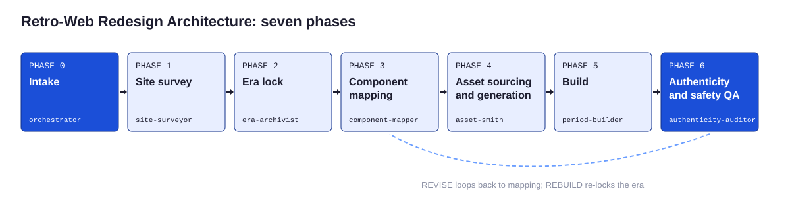

# The process

The Retro-Web Redesign Architecture (RWRA) has seven phases. Each has one question, one owner, a worksheet, and a contract for what it hands to the next phase. The generated [phase map](reference/phase-map.md) lists every step; this page explains why the order matters.



| Phase | Question | Owner | Output |
|---|---|---|---|
| 0 Intake | What are we redesigning, for whom, and under what rights? | orchestrator | `00-intake.md` |
| 1 Site survey | What does the modern site actually contain? | site-surveyor | `01-inventory/` |
| 2 Era lock | Which single era will this site live in? | era-archivist | `02-era-spec.json` |
| 3 Component mapping | What does each modern component become? | component-mapper | `03-mapping.md`, `03-copy-deck.md` |
| 4 Assets | What images and sounds does the build need, and may we use them? | asset-smith | `04-asset-log.csv`, images, audio |
| 5 Build | Does it look and read like it was made then, and behave safely now? | period-builder | `05-build/` |
| 6 QA | Would a visitor from then believe it, and is it safe for a visitor now? | authenticity-auditor | `06-qa/` |

## Why this order

**Rights before pixels.** Intake decides the asset policy and whether a disclaimer is needed. Those two answers change what the asset smith may produce and what the footer must say, so they come first.

**Inventory before era.** The survey is neutral. Choosing an era first biases what gets noticed: a builder who has already decided on MySpace will not see the docs section that has no MySpace equivalent.

**Era before mapping.** Every mapping decision depends on the preset. A testimonial becomes a guestbook entry in 1998, a quote page in 2001, and a comment in 2007.

**Mapping and copy before assets.** Buttons carry nav labels and banners carry page titles, so the sitemap and copy deck must exist first.

**Assets before build.** The builder writes markup around real file names and dimensions.

**A separate audit last.** The auditor scores against the era spec and the inventory without the builder's reasoning ([ADR-005](../adr/ADR-005-blind-auditor.md)).

## Human checkpoints

The orchestrator stops for the person at four points:

1. **After intake**, when purpose, rights, or asset policy is unclear.
2. **After era lock**, to confirm preset, year, and canvas.
3. **After mapping**, to approve drops and merges that lose a fact or call to action.
4. **Before shipping**, with the scorecard.

When the run is unattended, the orchestrator takes the most reasonable reading at checkpoints 1 to 3, writes it in the engagement decisions log, and continues. Checkpoint 4 is never skipped for client work.

## Loops

```
SHIP     -> ship report
REVISE   -> rows routed to their owner (usually mapping, assets, or build) -> re-audit, at most twice
REBUILD  -> back to era lock with the auditor's reasons
```

Routing by row is in [P10](../prompts/P10-fix-loop-and-ship.md).

## The engagement folder

```
engagements/<slug>/
  README.md            phase tracker and decisions log
  00-intake.md
  01-inventory/        inventory.json, notes.md
  02-era-spec.json
  03-mapping.md
  03-copy-deck.md
  04-asset-log.csv
  05-build/            pages, images/, audio/, recipe.json, safety layer
  06-qa/               scorecard.json, qa-notes.md, lint.json
```

`engagements/` is gitignored except for `.gitkeep`, so client work never lands in framework history by accident.

## Running it

| Mode | How |
|---|---|
| Claude Code, full | `/homestead <url> <preset or recommend>` |
| Claude Code, one phase | `/hs-survey`, `/hs-era`, `/hs-map`, `/hs-assets`, `/hs-build`, `/hs-audit` |
| By hand | The commands in each phase page, starting with `python3 tools/scaffold.py new` |
| Any chat tool | [P00](../prompts/P00-command-center.md), or P01 to P10 in sequence |

## Related reading

- [Site survey](03-site-survey.md)
- [Era lock](04-era-lock.md)
- [Agent architecture](11-agent-architecture.md)
