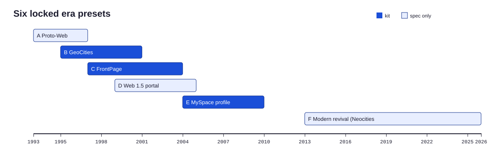

# Phase 2: Era lock

Era lock is the single most important design decision in HOMESTEAD. One preset, one year, one host context, written down so precisely that the builder cannot drift.

## The six presets

| Preset | Years | Canvas | Palette | Status |
|---|---|---|---|---|
| [A Proto-Web](presets/preset-a-proto-web.md) | 1993 to 1996 | fluid | browser default gray | spec only |
| [B GeoCities](presets/preset-b-geocities.md) | 1995 to 2000 | 600 px, 760 px late | web-safe 216 | kit |
| [C FrontPage](presets/preset-c-frontpage.md) | 1997 to 2003 | 760 px | theme, web-safe flat art | kit |
| [D Portal](presets/preset-d-portal.md) | 1999 to 2004 | 760 px | fuller color | spec only |
| [E MySpace](presets/preset-e-myspace.md) | 2004 to 2009 | 800 px | full color, glitter | kit |
| [F Revival](presets/preset-f-revival.md) | 2013 to now | any | deliberately retro | spec only |

Canvas widths follow screen resolution data: in January 2000, 800x600 was the most common resolution in one developer-heavy log, and by January 2004 1024x768 had overtaken it (STATED, [C-001](reference/evidence-register.md#c-001), [C-002](reference/evidence-register.md#c-002)). The specific widths are HOMESTEAD guidance (INFERENCE, [C-041](reference/evidence-register.md#c-041)).

## Choosing

| Brand signal | Preset |
|---|---|
| One person's voice, a creator, a hobby, a tiny shop | B |
| A company, a service, a catalog, B2B | C |
| Community, music, fashion, youth, social | E |
| Media, news, dense dashboards | D |
| Research, documentation, academia | A |
| A knowing tribute aimed at today's small web | F |

When the requester names a preset, use it. When they say recommend, use the table and write one sentence of justification.

## Filling the era spec card

Scaffold prefills `02-era-spec.json` from `templates/era-spec-cards/`. The archivist narrows it:

| Field | Rule |
|---|---|
| `year` | Inside the preset range, justified in one sentence |
| `host_context` | A concrete story, for example a SiliconValley neighborhood homestead for a software founder |
| `canvas_width_px` | Preset width; B is 600 for 1996 to 1998 and 760 for 1999 to 2000 |
| `palette` | Preset roles plus brand colors after snapping |
| `fonts` | Preset stacks; never web fonts for A to E |
| `required_widgets`, `required_any`, `forbidden_elements` | Copied from the preset unchanged |
| `voice_rules` | Preset voice plus who is speaking |
| `motion_budget`, `audio` | Preset values unless the intake asks for less |
| `time_capsule` | False unless a cross-era story is requested and written |
| `reference_urls` | Two or three archive pages for the auditor |
| `asset_policy` | From intake |

The card must validate against `schemas/era-spec.schema.json`.

## Era mixing and the time capsule

Mixing presets is the most visible failure of retro work. The lint enforces it through widget markers: every widget in a build is marked `<!-- hs:widget ID -->`, and any marker that is not allowed for the preset is an error (HL022).

Some stories legitimately span eras: a 1998 homepage last updated in 2006, with a MySpace link pasted at the bottom. Set `time_capsule: true`, write `time_capsule_story`, and list the extra widgets in `allowed_extra_widgets`. The lint then allows them, and the auditor scores row 1 against the story.

## Reference pages

| Preset | Where to look |
|---|---|
| B | [Restorativland GeoCities Gallery](https://geocities.restorativland.org) by neighborhood, [One Terabyte of Kilobyte Age](https://blog.geocities.institute) for period-browser screenshots, [GifCities](https://gifcities.org) for glyph styles |
| C, D | [Wayback Machine](https://web.archive.org) captures of the brand or its category leaders from 1997 to 2004 |
| E | Layout generator galleries for the fields users controlled (CORROBORATED, [C-039](reference/evidence-register.md#c-039)) |
| Any | The 1996 Space Jam site, still online (CORROBORATED, [C-028](reference/evidence-register.md#c-028)) |

Record URLs only. Asset sourcing belongs to Phase 4 and follows the asset policy.

## Related reading

- [Preset pages](presets/README.md)
- [Widget registry](reference/widget-registry.md)
- [ADR-002: one era per build](../adr/ADR-002-one-era-per-build.md)
