# Phase 3: Component mapping

Mapping turns the inventory into a plan. Every detected modern pattern gets one of three decisions, every required widget gets a page, and every word gets an era rewrite.



*FIG HS-05. Translate component by component.*

## Generate the worksheet

```bash
python3 tools/map.py engagements/acme/01-inventory/inventory.json \
  --spec engagements/acme/02-era-spec.json --out engagements/acme/03-mapping.md
```

The worksheet pre-fills each detected pattern with its canon equivalent for the locked preset and a default decision, caps navigation, lists required widgets with the pattern that supplies each, snaps colors, maps fonts to era stacks, and seeds the copy deck with every heading and CTA.

## Decisions

| Decision | When | Record |
|---|---|---|
| **MAP** | The canon equivalent fits | The page it lives on |
| **MERGE** | Two patterns become one element, or the survey misread a pattern | The row it merges into |
| **DROP** | No plausible period equivalent, or the equivalent would mislead | The reason, and whether a fact or CTA is lost |

Drops that lose a fact or CTA go to the human at checkpoint 3. The auditor scores content parity (row 12) against them.

## The mapping table at a glance

The full table, with detection signals, is [generated from canon](reference/mapping-table.md). A few translations carry most of the effect:

| Modern | B, 1998 | C, 2001 | E, 2007 |
|---|---|---|---|
| Hero | WordArt title and Welcome to my homepage! | Splash page or Flash-style intro | Glitter display name |
| Testimonials | Guestbook entries | What Our Customers Say | Comments wall |
| Analytics | Visible hit counter | Odometer or a [Hit Counter] placeholder | Profile Views |
| Customer logos | 88x31 button wall | Our Clients list | Top 8 friends |
| App or dashboard | Program window screenshot and Download Now! | Product Tour and Free 30-Day Trial | My Apps box |
| Cookie banner | Best viewed at 800x600 | This site requires a newer browser | Dropped |

## Navigation and sitemap

Cap navigation at five to eight items (canon `nav_cap_min` and `nav_cap_max`). The worksheet keeps the first items and sends the rest to a More Stuff! page for B or a site map page for C. Profiles (E) keep links in About Me and the network bar.

List every period page and the rows it carries. A typical B build has a home page, a guestbook, a links or FAQ page, and the text-only page. A typical C build has home, products and pricing, contact, and text-only, all sharing the same top, left, and bottom borders.

## Lived-in details

Period sites looked used. Plan at least three details from the era spec easter eggs: a slightly stale Last updated date, a visitor counter, an under construction section, a webring, a [Hit Counter] placeholder, a GENERATOR tag in source, an Online Now badge.

## The copy deck

Write `03-copy-deck.md`: page, slot, short source text, era rewrite.

| Rule | Why |
|---|---|
| Keep every fact, price, product name, and CTA accurate | Parity, and honesty about a real brand |
| Remove modern phrases: get started, book a demo, seamless, supercharge, unlock, AI-powered, we use cookies | The lint warns on them (HL011) and they break the era |
| Replace emoji with ASCII or GIF smileys | Emoji did not exist on the period web (HL006) |
| Never write real song lyrics | Copyright, including MySpace taglines and comments |
| Do not invent customers, quotes, awards, or numbers | Era framing may change delivery (download size, CD-ROM), not claims |

Voice examples per preset live on each [preset page](presets/README.md).

## Related reading

- [Mapping table](reference/mapping-table.md)
- [Widget registry](reference/widget-registry.md)
- [Worked example mapping, preset C](../examples/nimbus-ledger/mapping-C.md)
