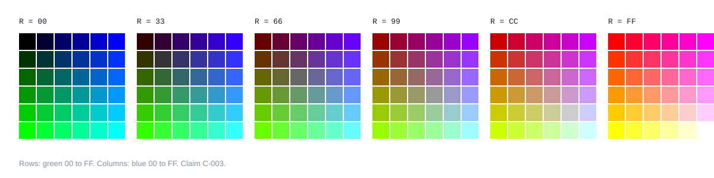

# Phase 4: Assets

Assets are where retro work usually gets into trouble: archived GIFs of unknown origin, ripped cartoon characters, real songs, self-hosted fonts. HOMESTEAD generates everything it can from scratch and logs everything it uses.

## Colors

The 216 web-safe colors are every combination of 00, 33, 66, 99, CC, and FF across red, green, and blue (CORROBORATED, [C-003](reference/evidence-register.md#c-003)). Presets A to C keep every flat color on that cube.

```bash
python3 tools/websafe.py snap "#6D28D9" "#0EA5E9"
```

Each channel rounds to the nearest level. If the per-channel result is more than delta E 10 away from the original, the tool picks the perceptually nearest web-safe color instead. Record both values in the asset log.

Period guidance kept the web-safe palette for flat art and used adaptive palettes for photographs (STATED, [C-004](reference/evidence-register.md#c-004)). HOMESTEAD follows the same rule.



## Logo

Rebuild the logo as pixel WordArt: the brand name in the 5x7 pixel font, scaled, with a row gradient and a drop shadow, on a transparent key for dark pages.

```bash
python3 tools/gifsmith.py one wordart 05-build/images/title.gif \
  --params '{"text": "ACME", "scale": 5, "shadow": "#660066", "outline": "#000000"}'
```

## Photos

```bash
python3 tools/dither.py hero.png 05-build/images/hero.gif --max-width 320
python3 tools/dither.py hero.png 05-build/images/hero.gif --palette websafe   # harsher, very 1996
```

Input must be an 8-bit PNG. The default is an adaptive median-cut palette with Floyd-Steinberg diffusion.

## Generated glyphs

`tools/gifsmith.py` draws every common period asset from shapes and a hand-entered pixel font, so nothing it makes carries third-party rights.

| Kind | Makes | Typical preset |
|---|---|---|
| `spacer` | 1x1 transparent GIF | all |
| `stars` | Star or sparkle tile | B, E |
| `rainbow` | Rainbow horizontal rule | B |
| `construction` | Animated under construction sign plus still | B, C |
| `new` | Animated NEW! plus still | B, C |
| `ball` | Shaded bullet ball | B, C |
| `digits` | Odometer digits 0 to 9 | B, C |
| `badge` | 88x31 badge with two text lines | B, C |
| `emailme` | Animated Email me envelope plus still | B |
| `wordart` | Pixel WordArt title or logo | all |
| `navbutton` | Beveled button and hover state | C |
| `banner` | Theme page banner | C |
| `tile` | Ruled-paper theme background | C |
| `appwindow` | Desktop program window screenshot | B, C |
| `glitter` | Glitter text plus still | E |
| `blinkie` | 150x20 blinkie plus still | E |
| `online` | Online Now! plus still | E |
| `avatar` | Identicon avatar for a Top 8 | E |
| `chiptune` | WAV plus MIDI from a tune | B, E |

Recipes make the build reproducible: each kit and example has a `recipe.json` that pulls named assets from the shared library and adds its own.

```bash
python3 tools/gifsmith.py recipe 05-build/recipe.json --out 05-build
```

Every animation is floored at 340 ms per frame, and every animated asset gets a `-still.gif` for Safe Mode.

## Audio

Browsers no longer autoplay background MIDI. HOMESTEAD renders a square-wave WAV that plays after a click, and a matching `.mid` file that sits in View Source inside a commented `bgsound` line.

```bash
python3 tools/chiptune.py list
python3 tools/chiptune.py render ode-to-joy 05-build/audio/theme.wav
```

Tunes are public-domain compositions sequenced fresh (Beethoven's Ode to Joy theme) or HOMESTEAD originals.

## The asset log

One row per file in `04-asset-log.csv`:

| Column | Example |
|---|---|
| file | images/title.gif |
| kind | wordart |
| source | generated |
| source_url | (blank for generated) |
| license | CC BY 4.0 |
| generator_or_author | tools/gifsmith.py wordart |
| era_check | pass |
| notes | Brand violet snapped to 6633CC |

## Asset policies

| Policy | Allows | Default for |
|---|---|---|
| originals-only | Generated or newly commissioned assets only | client work |
| archive-allowed | Generic archived glyphs (bullets, rules, construction signs), each logged with its source URL; never recognizable characters | portfolio and commentary |

See [legal and licensing](10-legal-and-licensing.md) and [ADR-004](../adr/ADR-004-originals-first-assets.md).

## Related reading

- [Build](07-build.md)
- [Accessibility and safety](09-accessibility-and-safety.md)
