# Phase 5: Build

The build is hand-written period markup with two modern lines. Open View Source on a finished page and you should see what a designer in the era year would have written, plus links to the safety layer.



*FIG HS-07. View Source never lies.*

## Start from a kit

```bash
python3 tools/scaffold.py new acme --target https://acme.example --preset B
```

Scaffold copies the preset kit into `05-build/`: pages, recipe, generated assets, and the safety layer. Kits exist for B, C, and E. Spec-only presets start from a blank page.

| Kit | Pages | Look |
|---|---|---|
| [Preset B](../kits/preset-b-geocities/README.md) | index, guestbook, text-only | Starry tile, WordArt, marquee, webring, counter |
| [Preset C](../kits/preset-c-frontpage/README.md) | index, text-only | Ledger Blue theme, shared borders, hover buttons |
| [Preset E](../kits/preset-e-myspace/README.md) | index, text-only | Profile tables with a user layout layered on top |

## Markup that reads as period

| Technique | Use | Still renders |
|---|---|---|
| Table layout with `cellpadding`, `cellspacing`, `bgcolor` | Everywhere; the biggest single signal | yes |
| Spacer GIFs | Gaps and indents | yes |
| `font face size color`, `center`, `b`, `i` | Text styling | yes |
| `body background bgcolor text link vlink alink` | Page colors | yes |
| `marquee` | One scrolling message | yes (C-006) |
| `map` and `area` | Banner navigation | yes |
| `webbot` comments, GENERATOR meta | FrontPage View Source | source only |
| User `style` block inside About Me | MySpace layouts | yes |

The full list, with claims, is the [technical vocabulary](reference/technical-vocabulary.md).

## Dead technology, emulated safely

| Original | Status today | HOMESTEAD emulation |
|---|---|---|
| `blink` | Does nothing (STATED, [C-007](reference/evidence-register.md#c-007)) | Keep the element; the safety layer animates it at one cycle per second and stops it in Safe Mode |
| `bgsound`, autostart MIDI | Blocked by autoplay policy | Keep the line inside an HTML comment; play a WAV only after a click |
| Framesets | Disputed support, poor for links and accessibility ([C-009](reference/evidence-register.md#c-009)) | Tables or styled iframes; never a real frameset |
| Java hover buttons, banner rotators | Dead | JavaScript image swaps with matching `onfocus` and `onblur`, exactly what careful developers did then (STATED, [C-019](reference/evidence-register.md#c-019)) |
| Flash intros | Blocked since January 2021 (STATED, [C-008](reference/evidence-register.md#c-008)) | HTML and CSS on a 550 by 400 stage with Skip Intro, or an original SWF through Ruffle |
| `window.status` scrollers | Ignored by browsers | A form text field ticker that checks `window.homesteadSafe()` |

## The safety layer on every page

```html
<head>
<link rel="stylesheet" href="homestead-safe.css">
<script src="homestead-safe.js" defer></script>
</head>
```

- Animated GIFs carry `data-still="images/name-still.gif"`.
- Sound uses `data-hs-audio="audio/theme.wav"` on a link or image.
- Period scripts check `window.homesteadSafe()` before animating.
- Every page links `text-only.html`, which is marked `<!-- hs:page text-only -->`.

Details: [safety layer](../kits/safety-layer/README.md) and [accessibility and safety](09-accessibility-and-safety.md).

## Widget markers

Put `<!-- hs:widget ID -->` next to every widget, with an ID from the [widget registry](reference/widget-registry.md). The lint uses markers to confirm every required widget is present (HL021) and to catch era mixing (HL022).

## Lint as you go

```bash
python3 tools/era_lint.py engagements/acme/05-build --spec engagements/acme/02-era-spec.json
```

In Claude Code the PostToolUse hook runs this after every Write or Edit on a build file and feeds errors back to the agent. Before handing over, run it with `--strict`, which fails on warnings too. The best verdict is NO FINDINGS (INCONCLUSIVE): the lint cannot judge whether the page looks right, only whether it contains known tells.

## The tells lint catches

Web fonts, rounded corners, blurred shadows, CSS gradients, flex and grid, emoji, SVG and srcset, responsive breakpoints, modern icon sets, framework fingerprints, modern marketing copy, autoplay audio, missing safety layer, real framesets, applets, Flash references, missing alt text, off-palette colors, missing required widgets, era mixing, off-era canvas width, custom properties and rem units, WebP and AVIF, lazy loading, modern CDNs, and the motion budget. The full table is [lint rules](reference/lint-rules.md).

## The tells only a person catches

- Even gutters and generous whitespace inside table cells.
- Body text at 16 px with 1.5 line height.
- Copy that is grammatically perfect and evenly paced.
- Widgets that are present but implausible for the brand.

## Related reading

- [Authenticity QA](08-authenticity-qa.md)
- [ADR-003: period markup with a safety layer](../adr/ADR-003-period-markup-with-safety-layer.md)
