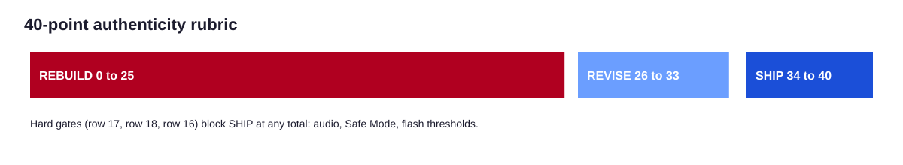

# Phase 6: Authenticity QA

QA asks two questions. Would a visitor from the era year believe this page? Is it safe and usable for a visitor today? Three tools gather evidence and one auditor decides.

## The tools

```bash
python3 tools/era_lint.py engagements/acme/05-build --spec engagements/acme/02-era-spec.json --format json > engagements/acme/06-qa/lint.json
python3 tools/gif_audit.py engagements/acme/05-build --page-bg "#000000"
python3 tools/rubric.py score engagements/acme/06-qa/scorecard.json --lint engagements/acme/06-qa/lint.json --write
```

| Tool | Checks | Best possible verdict |
|---|---|---|
| `era_lint.py` | 28 rules for anachronisms, safety, widgets, canvas, palette | NO FINDINGS (INCONCLUSIVE) |
| `gif_audit.py` | Frame timing against the 340 ms budget; luminance and red transitions against the WCAG flash area | WITHIN BUDGET (INCONCLUSIVE FOR SCALED OR TILED USE) |
| `rubric.py` | Totals the card, applies hard gates, caps lint-failing rows | SHIP |

No tool ever reports clean. The lint cannot see whether a page looks right; the audit measures a GIF at native size and cannot see how a page scales or tiles it ([ADR-007](../adr/ADR-007-no-clean-verdicts.md)).

## The blind auditor

The `authenticity-auditor` reads the era spec, the build, the inventory, and the asset log. It does not read the mapping rationale or the decisions log until its scores are final, and it has no write tools. The orchestrator records its scorecard verbatim ([ADR-005](../adr/ADR-005-blind-auditor.md)).

## The rubric



Twenty rows, each 0, 1, or 2, for a maximum of 40. Full descriptors: [rubric](reference/rubric.md).

| Rows | Area |
|---|---|
| 1 to 8 | Era fidelity: lock, canvas, colors, fonts, layout look, images, widgets present, widgets era-correct |
| 9 to 15 | Translation quality: voice, navigation, brand legibility, content parity, View Source, lived-in details, badges |
| 16 to 19 | Safety and accessibility: motion, audio, Safe Mode, accessibility basics |
| 20 | Legal hygiene |

| Verdict | Score | Action |
|---|---|---|
| SHIP | 34 to 40 | Ship with the scorecard |
| REVISE | 26 to 33 | Fix every row below 2 and re-audit |
| REBUILD | 25 or less | Re-lock the era and rebuild from mapping |

**Hard gates.** Audio (row 17) at least 1, Safe Mode (row 18) at 2, and motion (row 16) at least 1. A failed gate blocks SHIP at any total.

**Lint caps.** When `--lint` is given, any row tied to a lint rule with an error is capped at 1.

## Manual checks

From `templates/qa-notes.md`:

- View Source on every page reads as period markup apart from the two safety links.
- Safe Mode stops every marquee, blink, animated GIF, cursor effect, and sound.
- Safe Mode raises contrast enough to read every page.
- The text-only page carries every link and key fact.
- Keyboard alone reaches every control in a sensible order.
- Every image has alt text; spacers have empty alt.
- Every file in `images/` and `audio/` is in the asset log.
- Third-party marks are descriptive only; the disclaimer is present when needed.
- Two or three archive references were compared side by side.

## Reading a result

The worked example scored 39 on each build, never 40. Each lost point is a deliberate trade: generic badges instead of browser logos (rights), and modern features with no honest period slot (a login, a demo video). A perfect score is possible but should make the auditor suspicious.

| Build | Score | Row below 2 |
|---|---|---|
| [B, 1998](../examples/nimbus-ledger/qa/scorecard-B.json) | 39 | 15 Browser badges |
| [C, 2001](../examples/nimbus-ledger/qa/scorecard-C.json) | 39 | 12 Content parity |
| [E, 2007](../examples/nimbus-ledger/qa/scorecard-E.json) | 39 | 12 Content parity |

## Related reading

- [Lint rules](reference/lint-rules.md)
- [Accessibility and safety](09-accessibility-and-safety.md)
- [P09: blind audit prompt](../prompts/P09-authenticity-audit.md)
