# Accessibility and safety

The old web was bright, busy, slow, and loud. HOMESTEAD keeps the look and removes the harm: every effect has an off switch, nothing makes noise uninvited, and no animation can strobe.

*FIG HS-08. Keep the chaos. Give it an off switch.*

## Standards in play

| Standard | Requirement | HOMESTEAD answer |
|---|---|---|
| WCAG 2.3.1, Level A | No more than three flashes in any one second unless below the general and red flash thresholds; the 10 degree field is estimated as 341 x 256 px at 1024 x 768 (STATED, [C-021](reference/evidence-register.md#c-021)) | 340 ms frame floor in gifsmith; gif_audit measures transition area and rate |
| WCAG 2.2.2, Level A | Moving content that starts automatically and lasts over five seconds needs pause, stop, or hide | Safe Mode stops marquees, blink, GIFs, and scripted effects |
| WCAG 1.4.2, Level A | Audio playing over three seconds needs pause, stop, or volume control (STATED, [C-022](reference/evidence-register.md#c-022)) | Audio only after a click; a second click or Safe Mode stops it |
| prefers-reduced-motion | Respect the visitor's system setting | Safe Mode starts on; animated images stay hidden until stills are swapped in |

## The flash budget

Two-frame full-contrast alternation reaches three flashes per second at roughly 167 ms per frame. HOMESTEAD floors every frame at 340 ms, about half the limit (INFERENCE, [C-043](reference/evidence-register.md#c-043)). Frames declared at 0 or 1 centisecond are treated as 100 ms, matching common browser clamping (INFERENCE, verify per browser).

`gif_audit.py` then decodes every animation, composites frames honoring disposal methods, and counts pixels whose relative luminance changes by 0.1 or more with the darker side under 0.8, plus saturated-red transitions. A transition is flash-capable when that area reaches 25 percent of 341 x 256 pixels. More than three flash-capable flashes in any one second fails.

The audit measures a GIF at its native size. A small GIF scaled up in markup, tiled as a background, or repeated many times on a page can flash where the file alone does not. That is why its best verdict says INCONCLUSIVE FOR SCALED OR TILED USE, and why HOMESTEAD forbids animated background tiles.

## Safe Mode

A button labeled SAFE MODE, fixed at the bottom right and first in tab order. When on:

- every `img[data-still]` swaps to its still frame,
- every `marquee` is hidden and its content shown as static text,
- `blink` emulation stops,
- audio stops and will not start,
- background images are removed, backgrounds turn white, text turns black, links return to standard blue and purple,
- custom cursors are removed,
- period scripts that check `window.homesteadSafe()` pause.

The choice is remembered per browser when storage is available, and Safe Mode starts on for visitors who prefer reduced motion. Source: [kits/safety-layer](../kits/safety-layer/README.md).

## Motion budget

Each preset caps moving items per page: B 4, C 3, D 3, E 6, F 5, A 0. Marquee, blink, and every animated GIF count. The lint warns when a page exceeds its budget (HL028).

## Keyboard and screen readers

- The Safe Mode toggle is a real `button`, inserted first in the body.
- Hover-swap navigation mirrors `onmouseover` and `onmouseout` with `onfocus` and `onblur`.
- Click-to-play controls get `role="button"` and `aria-pressed`, and announce state through a polite live region.
- Form fields use `label for`.
- Every image has alt text; spacer GIFs use `alt=""`.

## The text-only page

Every build ships `text-only.html`, linked from every page. It carries every fact, price, and link in plain HTML with no images, motion, or sound. This is period-correct (many sites offered a text-only or printer-friendly version) and is the main escape hatch for anyone the period page does not serve.

## What Safe Mode is not

Safe Mode is a mechanism, not a guarantee. It does not fix low-contrast text baked into an image, a page that is confusing to navigate, or an animation that was never given a still frame. The auditor checks those by hand (rubric rows 16 to 19).

## Related reading

- [Safety layer](../kits/safety-layer/README.md)
- [Authenticity QA](08-authenticity-qa.md)
- [P08: safety pass](../prompts/P08-safety-pass.md)
