# Agent architecture

HOMESTEAD follows the BHIL CADRE pattern: one orchestrator over specialist subagents, each with a narrow job, a restricted tool list, and a written contract. Governing agents is a delegation and management discipline, not a prompting exercise.



*FIG HS-10. The crew's Top 8. One of them can't write.*

## Roster

| Agent | Phase | Model | Tools | Cannot | Contract |
|---|---|---|---|---|---|
| orchestrator | 0, checkpoints | Opus | all | n/a | Engagement record, sequencing, sign-off |
| `site-surveyor` | 1 | Sonnet | Read, Write, Bash, WebFetch, Glob | Edit | Schema-valid inventory plus notes |
| `era-archivist` | 2 | Sonnet | Read, Write, WebSearch, WebFetch, Glob | Bash, Edit | Schema-valid era spec with references |
| `component-mapper` | 3 | Sonnet | Read, Write, Edit, Bash, Glob | WebFetch, WebSearch | Every pattern decided; copy deck free of modern tells |
| `asset-smith` | 4 | Sonnet | Read, Write, Bash, Glob | WebSearch, Edit | Every file logged; no audit failures |
| `period-builder` | 5 | Sonnet | Read, Write, Edit, Bash, Glob, Grep | WebSearch, WebFetch | Lint exits 0 on every page |
| `authenticity-auditor` | 6 | Sonnet | Read, Glob, Grep, Bash | Write, Edit, WebSearch, WebFetch | Complete scorecard with evidence |

The roster is canon (`canon/agents.json`). `scripts/validate.py` fails if any file in `.claude/agents/` lists different tools or a different model.

## Why each restriction

- **Surveyor cannot Edit.** It records; it should never tidy a page it is supposed to describe.
- **Archivist has no Bash.** Era choice is judgment and research, not tooling.
- **Mapper has no web access.** It works from the inventory, so its decisions trace back to evidence.
- **Asset smith has no web search.** Originals-only by construction; archive sourcing needs a human decision.
- **Builder has no web access.** No CDNs, no remote assets, no copying.
- **Auditor cannot write.** The work never grades itself ([ADR-005](../adr/ADR-005-blind-auditor.md)).

## Running it

```text
/homestead https://acme.example recommend
/homestead saved/acme.html C acme
```

Single phases: `/hs-survey`, `/hs-era`, `/hs-map`, `/hs-assets`, `/hs-build`, `/hs-audit`. Definitions live in `.claude/commands/`.

## The lint hook

`.claude/settings.json` registers `scripts/hook_era_lint.py` as a PostToolUse hook on Write and Edit. When an agent writes an HTML or CSS file inside an engagement build, a kit, or an example build, the hook lints that build against its era spec. On errors it exits 2 and prints the findings, which Claude Code feeds back to the agent before it continues. Anything else passes through silently.

## Permissions

| Allowed | Denied |
|---|---|
| Read anywhere | Writes to `canon/` and derived folders |
| `python3 tools/*`, the validator, the drift gate, the tests | `rm -rf`, force push |
| Write and Edit under `engagements/` | Edits to `.claude/settings.json` |

Canon changes are maintainer work, made by hand, rebuilt with `scripts/build_derived.py`, and reviewed.

## Handoffs

Each delegation passes paths, not file contents: the slug, the files the agent needs, and the contract it must return. Each subagent returns a short summary plus the paths it wrote. The orchestrator updates the engagement README phase tracker and decisions log after every handoff, so a person who steps away can see what happened.

## Without Claude Code

| Surface | Use |
|---|---|
| Any chat tool | [P00](../prompts/P00-command-center.md) in one pass, or P01 to P10 in sequence |
| A chat surface with skills | The [portable skill](../skill/README.md) |
| Another agent tool | [AGENTS.md](https://github.com/PolymathWizard/BHIL-Homestead/blob/main/AGENTS.md) is vendor-neutral; map each subagent to a role with the same tool limits |

## Related reading

- [Agent roster (generated)](reference/agent-roster.md)
- [Process](02-process.md)
- [Prompt system](../prompts/README.md)
