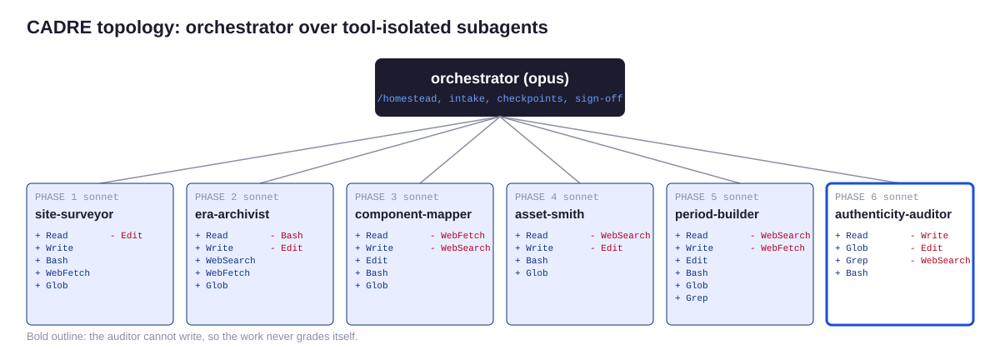

<!-- Generated from canon/ by scripts/build_derived.py. Do not edit by hand; edit canon and rebuild. -->

# Agent roster

CADRE: one orchestrator session over tool-isolated subagents. The orchestrator owns the engagement folder, sequencing, and human checkpoints. Subagents own one phase each and hand back a contract, not a conversation.

| Agent | Phase | Model | Tools | Forbidden | Writes | Contract |
|---|---|---|---|---|---|---|
| orchestrator | 0 and checkpoints | opus | all | none | engagement folder | owns sequencing and sign-off |
| `site-surveyor` | 1 | sonnet | Read, Write, Bash, WebFetch, Glob | Edit | engagements/<slug>/01-inventory/ | inventory.json valid against schemas/inventory.schema.json plus notes.md |
| `era-archivist` | 2 | sonnet | Read, Write, WebSearch, WebFetch, Glob | Bash, Edit | engagements/<slug>/02-era-spec.json | era spec valid against schemas/era-spec.schema.json with two or more reference URLs |
| `component-mapper` | 3 | sonnet | Read, Write, Edit, Bash, Glob | WebFetch, WebSearch | engagements/<slug>/03-mapping.md and 03-copy-deck.md | every detected pattern has a map, merge, or drop decision; copy deck passes HL011 |
| `asset-smith` | 4 | sonnet | Read, Write, Bash, Glob | WebSearch, Edit | engagements/<slug>/04-asset-log.csv and 05-build/images/ | every file in images is in the asset log with source, license, and era check |
| `period-builder` | 5 | sonnet | Read, Write, Edit, Bash, Glob, Grep | WebSearch, WebFetch | engagements/<slug>/05-build/ | era_lint exits 0 for every page |
| `authenticity-auditor` | 6 | sonnet | Read, Glob, Grep, Bash | Write, Edit, WebSearch, WebFetch | nothing; returns the scorecard JSON and notes to the orchestrator | complete 20-row scorecard with evidence per row and a verdict from tools/rubric.py |

Definitions live in `.claude/agents/`. `scripts/validate.py` fails if any definition's tools drift from this table.
