<!-- Generated from canon/ by scripts/build_derived.py. Do not edit by hand; edit canon and rebuild. -->

# Lint rules

Exempt files: `homestead-safe.css`, `homestead-safe.js`. Severity is per preset; a blank cell means the rule does not apply.

*FIG HS-07. View Source never lies.*

| ID | Rule | A | B | C | D | E | F | Row | Fix |
|---|---|---|---|---|---|---|---|---|---|
| HL001 | Web font loaded | error | error | error | error | error |  | 4 | Use a system font stack from canon/fonts.json. Never self-host Comic Sans. |
| HL002 | Rounded corners | error | error | error | error | warn |  | 5 | Draw rounded shapes as GIF corner images or drop them. |
| HL003 | Blurred box shadow | error | error | error | error | warn |  | 5 | Bake shadows into GIFs or use a table cell of a darker color. |
| HL004 | CSS gradient | error | error | error | error | warn |  | 5 | Render gradients into a tiled GIF. |
| HL005 | Flexbox or grid layout | error | error | error | error | error |  | 5 | Use table layouts with cellpadding, cellspacing, and spacer GIFs. |
| HL006 | Emoji character | error | error | error | error | error |  | 9 | Use GIF smileys or ASCII such as :-) |
| HL007 | SVG or responsive image markup | error | error | error | error | error |  | 6 | Export GIF or low-quality JPEG at a single small size. |
| HL008 | Responsive media query | error | error | error | error | error |  | 2 | Remove breakpoints. Offer a scaled view in the delivery wrapper if needed. |
| HL009 | Modern icon set | error | error | error | error | error |  | 20 | Generate pixel glyphs with tools/gifsmith.py. |
| HL010 | Modern framework fingerprint | error | error | error | error | error |  | 13 | Hand-write period markup. Only the safety layer may be modern. |
| HL011 | Modern marketing copy | warn | warn | warn | warn | warn |  | 9 | Rewrite in the preset voice from canon/presets.json. |
| HL012 | Autoplaying audio | error | error | error | error | error | error | 17 | Use the safety layer click-to-play control (data-hs-audio). Keep any bgsound line inside an HTML comment for View Source flavor. |
| HL013 | Blink without the safety layer | error | error | error | error | error | error | 16 | Link homestead-safe.css, which animates blink at one cycle per second and stops it in Safe Mode. |
| HL014 | Marquee without the safety layer | error | error | error | error | error | error | 16 | Link homestead-safe.js, whose Safe Mode stops every marquee. |
| HL015 | Safety layer missing | error | error | error | error | error | error | 18 | Copy kits/safety-layer next to the build and link both files in the head. |
| HL016 | Real frameset | error | error | error | error | error |  | 10 | Emulate frames with tables or iframes inside a fixed layout. |
| HL017 | Java applet | error | error | error | error | error |  | 13 | Rebuild hover buttons and banner rotators as image swaps. A gray applet-loading box may stay as flavor. |
| HL018 | Flash file reference | warn | warn | warn | warn | warn | warn | 13 | Build the intro in HTML and CSS on a 550 by 400 stage, or ship an original SWF through Ruffle. |
| HL019 | Image without alt text | warn | warn | warn | warn | warn | warn | 19 | Add alt text. Period-style alt such as [Under Construction] is fine. |
| HL020 | Flat color off the web-safe palette | warn | warn | warn |  |  |  | 3 | Run tools/websafe.py snap and record the before and after in the asset log. |
| HL021 | Required widget missing | warn | warn | warn | warn | warn | warn | 7 | Add the widget and its <!-- hs:widget ID --> marker, or record why it was dropped in the mapping worksheet. |
| HL022 | Era mixing | error | error | error | error | error | error | 8 | Remove it, or set time_capsule true in the era spec and explain the story. |
| HL023 | Canvas width off era |  | warn | warn | warn | warn |  | 2 | Set the outer table width to the preset canvas width within 40 px. |
| HL024 | Modern CSS feature | error | error | error | error | error |  | 5 | Use px, attributes, and plain CSS1 or CSS2 declarations. |
| HL025 | Modern image format | error | error | error | error | error |  | 6 | Use GIF or JPEG. |
| HL026 | Modern loading attributes | warn | warn | warn | warn | warn |  | 13 | Remove them; period pages are small. |
| HL027 | Modern CDN | warn | warn | warn | warn | warn |  | 13 | Ship files next to the page. |
| HL028 | Motion budget exceeded | warn | warn | warn | warn | warn | warn | 16 | Cut motion or move items below the fold. Budgets live in canon/presets.json. |

## Verdicts

- **FINDINGS**: At least one error-severity finding. The build does not pass.
- **WARNINGS ONLY**: No errors, at least one warning. Review every warning before scoring.
- **NO FINDINGS (INCONCLUSIVE)**: No rule fired. Lint cannot judge visual authenticity, copy quality, or flash luminance, so absence of findings is never a clean bill. Score the rubric.
