<!-- Generated from canon/ by scripts/build_derived.py. Do not edit by hand; edit canon and rebuild. -->

# Modern to retro mapping table

Translate component by component, not page by page. Every inventoried pattern gets a row decision: map, merge, or drop with a reason.

*FIG HS-05. Translate component by component.*

| Modern pattern | B: GeoCities | C: FrontPage | E: MySpace | Tier |
|---|---|---|---|---|
| Hero section | Big centered WordArt title, an animated GIF, and Welcome to my homepage! | Splash page with logo and ENTER link, or a Flash-style intro with Skip Intro | Profile banner image plus a glitter display name | STATED |
| Sticky header or hamburger menu | Text links separated by pipes at top and bottom | Left shared border of theme buttons, or a left frame emulation | Thin network nav bar across the top | STATED |
| Mega-menu | A Site Map page | Image map navigation banner | Links typed into About Me | STATED |
| Cards or feature grid | Bulleted list with ball bullet GIFs | Two or three column table with border=1 and theme bullets | Interests table rows | STATED |
| Pricing table | Prices page with a bordered table | Catalog table with an Order Form that posts to mailto or Save Results | Details table rows | STATED |
| Testimonials | Guestbook entries such as Cool site!! | What Our Customers Say page with italic quotes | Comments wall with Thanks for the add graphics | STATED |
| Blog, changelog, or news | What's New log with dated entries and NEW graphics | Press Releases page with a Timestamp line | Blog or Bulletins box | STATED |
| Social icons | Webring box, an Email me graphic, and an ICQ number or AIM screen name | Contact Us feedback form | Contact table with Send Message, Add to Friends, and Instant Message | STATED |
| Analytics | Visible hit counter: You are visitor #004217 | Odometer hit counter, or a [Hit Counter] placeholder | Profile Views count | STATED |
| Cookie banner | Best viewed at 800x600 badge | This site uses frames or requires a newer browser notice | Dropped: profiles carried no equivalent | STATED |
| Newsletter signup | Join my mailing list form, or Sign my guestbook | Subscribe to our e-Newsletter form | Add to Friends | STATED |
| Site search | Search this site box, FreeFind style | Search component form | Network search bar | STATED |
| Product pages or shop | Photo, description, and price in a table | Catalog table with thumbnails linking to larger JPEGs | Dropped: list items in About Me instead | STATED |
| SaaS app or dashboard | Screenshots page of a desktop program window and a Download Now! (2.3 MB) link | Product Tour with numbered screenshots and a Free 30-Day Trial download | My Apps module | STATED |
| Login | Members Only password page | Registration component or login form in a gray table | Network login box | STATED |
| Chatbot or live chat | Chat Room link, or Leave a message on my ICQ | Live Help pop-up, or Email our Webmaster | Instant Message link in the contact table | STATED |
| Video | Click here to download (QuickTime, 4.1 MB) | Embedded media box with a player-style frame | Embedded video player box | STATED |
| Docs or help center | FAQ page with anchor links | Support section with a Table of Contents line | Dropped | STATED |
| FAQ accordion | FAQ page with Q: and A: pairs and a Back to top link | FAQ page with a numbered question list and bookmarks | Who I'd Like to Meet written as questions | INFERENCE |
| Dark mode | Black or starry background is already the default; add a text-only version link | Printer-friendly version link | Pick a dark user layout | STATED |
| Careers | Help Wanted! graphic | Employment Opportunities page | Dropped | STATED |
| Customer logo strip | Cool Sites I Like list or an 88x31 button wall | Our Clients bulleted list with small logo GIFs | Top 8 friends | INFERENCE |
| Footer | Last updated date, mailto, webring, award badges, and the counter | Copyright company Inc. All rights reserved, Webmaster line, and Best viewed with a browser badge | Network footer links | STATED |
| Accessibility statement | Text-only version link | Text-only version link | Text-only version link | STATED |

## Detection signals

Signals are case-insensitive regular expressions run by tools/survey.py. html signals match raw markup, text signals match visible text, href signals match link targets, script signals match script sources and inline script, css signals match style blocks and linked same-origin stylesheets.

| Pattern | Signals |
|---|---|
| Hero section | html: `<h1[\s>]` |
| Sticky header or hamburger menu | html: `<nav[\s>]` html: `aria-label="[^"]*menu` html: `<header[\s>]` css: `position:\s*(sticky/fixed)` |
| Mega-menu | html: `<nav[^>]*>(?:(?!</nav>).){0,4000}<ul(?:(?!</nav>).){0,4000}<ul` |
| Cards or feature grid | html: `class="[^"]*(card/feature)[^"]*"` css: `display:\s*grid` |
| Pricing table | html: `class="[^"]*pric` text: `pricing` text: `per month` text: `/mo\b` text: `per seat` href: `/pricing` |
| Testimonials | html: `<blockquote` html: `class="[^"]*(testimonial/review/quote)` |
| Blog, changelog, or news | text: `changelog` text: `what's new` text: `latest posts` href: `/blog` href: `/news` href: `/changelog` href: `/updates` |
| Social icons | href: `twitter\.com` href: `x\.com/` href: `linkedin\.com` href: `facebook\.com` href: `instagram\.com` href: `youtube\.com` href: `github\.com` href: `tiktok\.com` href: `threads\.net` href: `bsky\.app` |
| Analytics | script: `googletagmanager` script: `google-analytics` script: `gtag\(` script: `plausible` script: `segment\.(com/io)` script: `mixpanel` script: `hotjar` script: `posthog` script: `amplitude` |
| Cookie banner | html: `class="[^"]*cookie` html: `id="[^"]*cookie` text: `we use cookies` text: `accept all` text: `cookie preferences` script: `cookiebot` script: `onetrust` script: `cookieyes` |
| Newsletter signup | html: `type="email"` text: `newsletter` text: `subscribe` |
| Site search | html: `type="search"` html: `role="search"` href: `/search` script: `algolia` script: `docsearch` |
| Product pages or shop | text: `add to cart` text: `buy now` href: `/product` href: `/shop` href: `/store` href: `/cart` script: `shopify` |
| SaaS app or dashboard | text: `dashboard` text: `start free trial` text: `free trial` href: `app\.` href: `/dashboard` href: `/signup` href: `/register` |
| Login | html: `type="password"` text: `log in` text: `sign in` href: `/login` href: `/signin` href: `/sign-in` |
| Chatbot or live chat | text: `chat with us` script: `intercom` script: `drift\.com` script: `crisp\.chat` script: `zendesk` script: `tawk\.to` script: `hs-scripts` script: `livechat` |
| Video | html: `<video[\s>]` html: `<iframe[^>]+(youtube/vimeo/wistia/loom)` |
| Docs or help center | text: `documentation` text: `help center` href: `/docs` href: `/help` href: `/support` href: `docs\.` |
| FAQ accordion | html: `<details[\s>]` html: `class="[^"]*(faq/accordion)` text: `frequently asked` text: `\bfaq\b` |
| Dark mode | html: `data-theme` html: `class="[^"]*theme-toggle` text: `dark mode` css: `prefers-color-scheme` |
| Careers | text: `we're hiring` text: `join our team` href: `/careers` href: `/jobs` |
| Customer logo strip | html: `alt="[^"]*logo` text: `trusted by` text: `used by` |
| Footer | html: `<footer[\s>]` |
| Accessibility statement | text: `accessibility` href: `/accessibility` |
