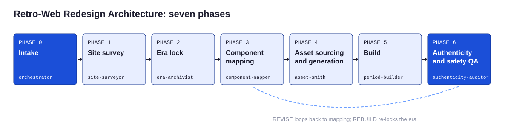

<!-- Generated from canon/ by scripts/build_derived.py. Do not edit by hand; edit canon and rebuild. -->

# Phase map: Retro-Web Redesign Architecture (RWRA)

A retro redesign is a translation, not a costume. Lock one era, inventory the modern site, map every component to its period equivalent, build in period markup, then let a separate auditor grade it.

## Phase 0: Intake

*What are we redesigning, for whom, and under what rights?*

Owner: `orchestrator`. Prompt: [P01](../../prompts/README.md). Worksheet: `templates/intake.md`. Tools: `tools/scaffold.py`.

1. Capture the target URL or saved HTML
2. Record purpose: client, portfolio, commentary, or internal
3. Record audience and deliverable: static mock, live site, screenshots, or video
4. Choose the asset policy: originals-only or archive-allowed
5. Note legal context: own brand, client brand, or third-party brand

Outputs: `00-intake.md`.

## Phase 1: Site survey

*What does the modern site actually contain?*

Owner: `site-surveyor`. Prompt: [P02](../../prompts/README.md). Worksheet: `templates/inventory.schema.json`. Tools: `tools/survey.py`.

1. Fetch the top page and up to ten same-origin pages
2. Extract navigation, information architecture, headings, CTAs, forms, embeds, and scripts
3. Extract brand colors and font families from markup and stylesheets
4. Detect modern patterns against canon/mapping.json signals
5. Capture tone of voice notes and screenshot references

Outputs: `01-inventory/inventory.json`, `01-inventory/notes.md`.

## Phase 2: Era lock

*Which single era will this site live in?*

Owner: `era-archivist`. Prompt: [P03](../../prompts/README.md). Worksheet: `templates/era-spec-cards`. Tools: none.

1. Recommend a preset from purpose, brand, and audience
2. Set year, browser, canvas width, palette mode, fonts, and layout mode
3. Copy required widgets and forbidden elements from the preset
4. Set motion budget, audio mode, and easter eggs
5. Pull two or three reference pages from the archives for the preset
6. Decide whether a time capsule story is intended and write it down

Outputs: `02-era-spec.json`.

## Phase 3: Component mapping

*What does each modern component become?*

Owner: `component-mapper`. Prompt: [P04](../../prompts/README.md). Worksheet: `templates/mapping-worksheet.md`. Tools: `tools/map.py`.

1. Generate the mapping worksheet from the inventory and era spec
2. Decide map, merge, or drop for every detected pattern
3. Cap navigation at five to eight items and plan the sitemap
4. Plan lived-in details
5. Write the era copy deck in the preset voice

Outputs: `03-mapping.md`, `03-copy-deck.md`.

## Phase 4: Asset sourcing and generation

*What images, colors, and sounds does the build need, and are we allowed to use them?*

Owner: `asset-smith`. Prompt: [P06](../../prompts/README.md). Worksheet: `templates/asset-log.csv`. Tools: `tools/websafe.py`, `tools/gifsmith.py`, `tools/dither.py`, `tools/chiptune.py`.

1. Snap brand colors to the web-safe cube and log the deltas
2. Rebuild the logo as a WordArt-style or beveled GIF
3. Downscale and dither photos
4. Generate buttons, badges, counters, rules, tiles, and glitter with original tooling
5. Render the click-to-play track
6. Log every asset with source, license, and era check

Outputs: `04-asset-log.csv`, `05-build/images/`.

## Phase 5: Build

*Does the page look and read like it was made then, and behave safely now?*

Owner: `period-builder`. Prompt: [P07](../../prompts/README.md). Worksheet: `kits/`. Tools: `tools/era_lint.py`.

1. Start from the preset kit and the safety layer
2. Write period markup at the canvas width
3. Place every mapped component and widget marker
4. Wire Safe Mode, click-to-play audio, and the text-only page
5. Lint after every file and fix errors before moving on

Outputs: `05-build/`.

## Phase 6: Authenticity and safety QA

*Would a 1998 visitor believe it, and is it safe for a 2026 visitor?*

Owner: `authenticity-auditor`. Prompt: [P09](../../prompts/README.md). Worksheet: `templates/scorecard.json`. Tools: `tools/era_lint.py`, `tools/gif_audit.py`, `tools/rubric.py`.

1. Run the anachronism lint against the era spec
2. Run the GIF timing audit
3. Score the 40-point rubric without reading the builder's notes
4. Check View Source, the text-only page, and keyboard paths
5. Check the asset log and legal notes
6. Issue SHIP, REVISE, or REBUILD with rows to fix

Outputs: `06-qa/scorecard.json`, `06-qa/qa-notes.md`.
