<!-- Generated from canon/ by scripts/build_derived.py. Do not edit by hand; edit canon and rebuild. -->

# Authenticity rubric

Score each row 0, 1, or 2. Maximum 40.

*FIG HS-09. Graded blind. Scored to forty.*

| Row | Check | 0 | 1 | 2 | Lint rules |
|---|---|---|---|---|---|
| 1 | Era locked to one preset | Mixed | Mostly consistent | Fully consistent or explicitly time-capsuled | HL022 |
| 2 | Canvas width matches era | Fluid or responsive | Fixed but wrong width | Fixed at era width | HL023, HL008 |
| 3 | Colors | Off-palette | Mostly web-safe | All flat colors web-safe (presets A to C) | HL020 |
| 4 | Fonts | Web fonts | System fonts, wrong era | Era-correct system fonts only | HL001 |
| 5 | Layout engine look | Flex or grid feel | Tables but too tidy | Visible table borders and spacer quirks | HL005, HL024 |
| 6 | Images | Retina or SVG | Downscaled | Dithered GIF or artifacted JPEG | HL007, HL025 |
| 7 | Widgets present | None | Some | Full era set | HL021 |
| 8 | Widgets era-correct | Anachronistic | Minor slips | All era-correct | HL022 |
| 9 | Copy voice | Modern marketing | Partially rewritten | Fully era-voiced | HL011, HL006 |
| 10 | Navigation | Modern header | Retro-styled modern | Frames emulation, shared borders, image map, or text links | manual |
| 11 | Brand legibility | Unrecognizable | Recognizable with effort | Instantly recognizable | manual |
| 12 | Content parity | Under half of the IA mapped | Most mapped | All key IA and CTAs mapped | manual |
| 13 | View Source | Modern framework output | Mixed | Period-style markup and comments | HL010, HL026, HL027 |
| 14 | Lived-in details | None | Some | Last updated, visitor count, a broken-component placeholder, or under construction pages | manual |
| 15 | Browser badges | Missing | Generic | Era-matched | manual |
| 16 | Motion | None, or modern easing, or over flash thresholds | Retro but excessive | Era-appropriate GIF and marquee use, under flash thresholds | HL014, HL013 |
| 17 | Audio | Autoplays | Click-to-play, wrong format | Click-to-play period-style track with a visible control | HL012 |
| 18 | Safe Mode | None | Partial | Full toggle covering motion, audio, and contrast | HL015 |
| 19 | Accessibility basics | Fails | Partial | Alt text, keyboard navigation, and a text-only link | HL019 |
| 20 | Legal hygiene | Uncleared assets | Partial | Asset log, font plan, and disclaimer as needed | HL009 |

## Bands

| Verdict | Score | Action |
|---|---|---|
| SHIP | 34 to 40 | Ship. Record the scorecard with the build. |
| REVISE | 26 to 33 | Revise every row that scored below 2, then re-score. |
| REBUILD | 0 to 25 | Re-lock the era and rebuild from the mapping step. |

## Hard gates

A build cannot SHIP while any gate fails, whatever the total.

- Row 17 must score at least 1. Autoplaying audio fails WCAG 1.4.2 regardless of total score.
- Row 18 must score at least 2. Safe Mode ships on every build.
- Row 16 must score at least 1. Motion over flash thresholds fails WCAG 2.3.1 regardless of total score.
