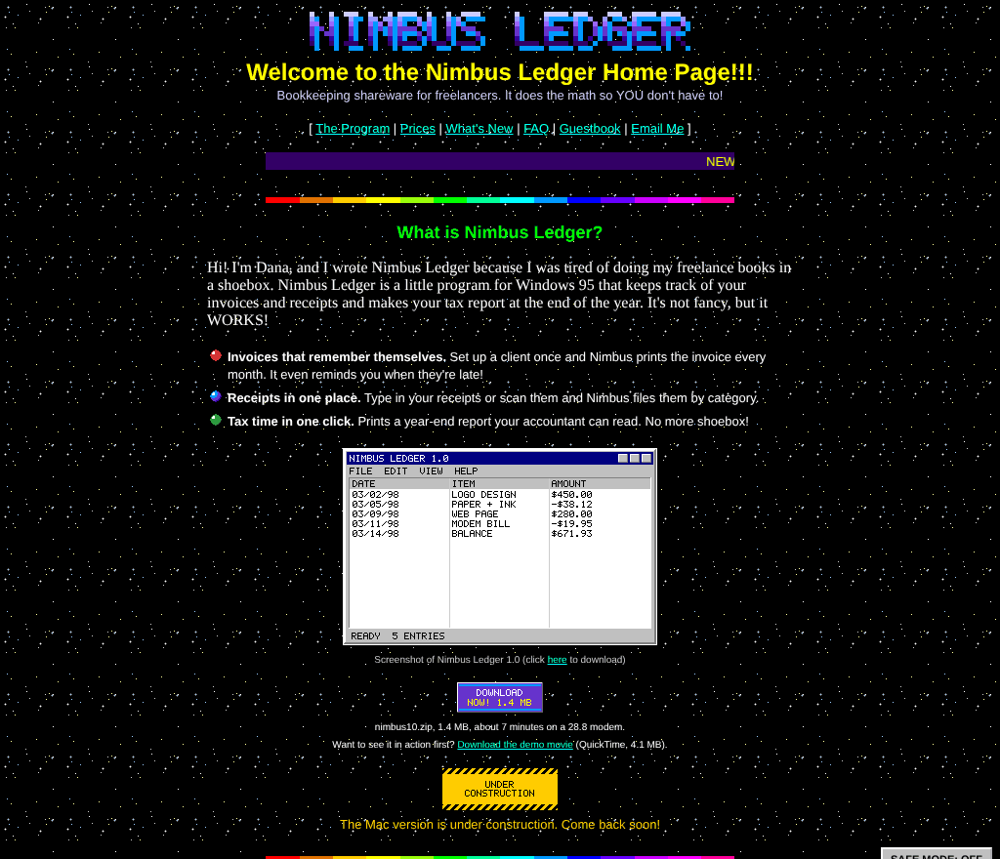
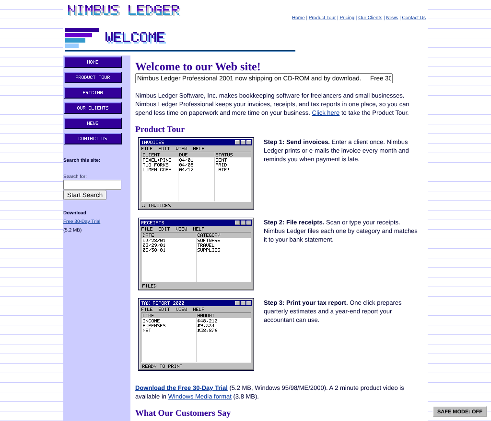
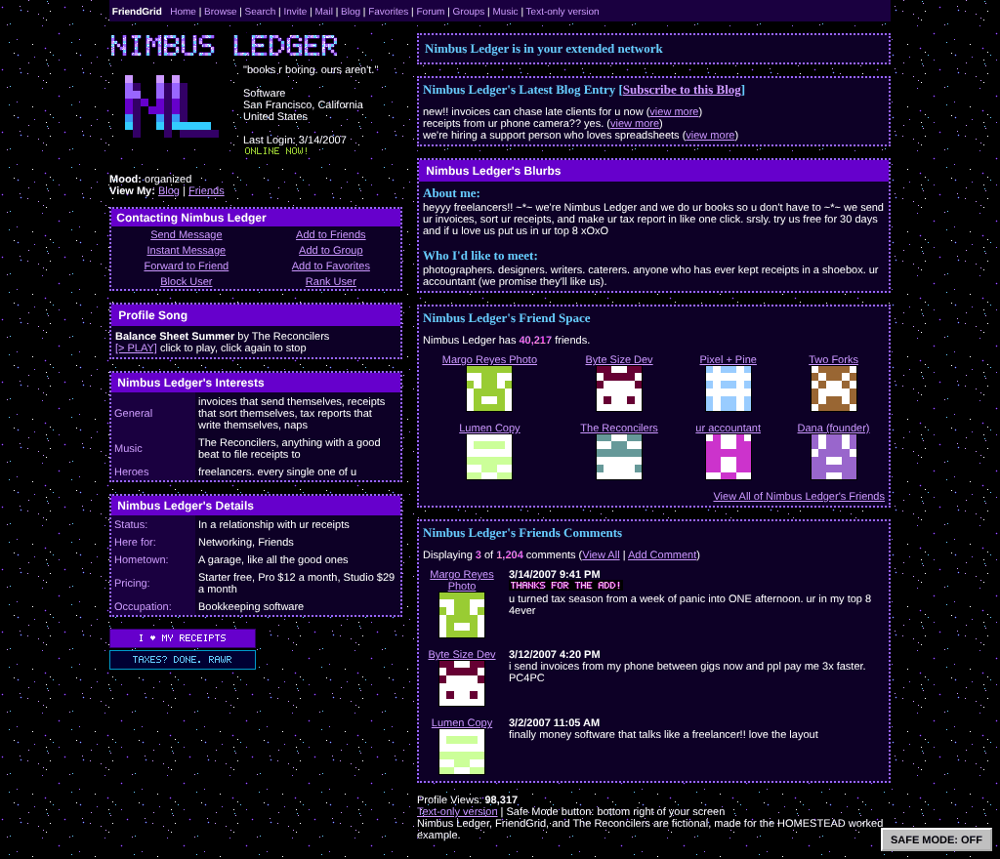
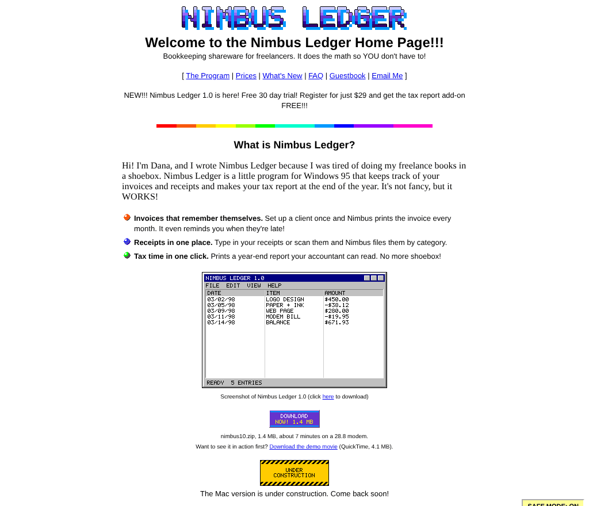

# Worked example: Nimbus Ledger

Nimbus Ledger is a fictional bookkeeping app for freelancers, written as a typical 2026 landing page: sticky header, gradient buttons, Inter from Google Fonts, a feature card grid, a cookie banner, a chat widget, and copy that says get started and book a demo. This folder takes that one page through every HOMESTEAD phase and out the other side as three period sites.

| Build | Preset | Year | Pages | Score |
|---|---|---|---|---|
| [preset-b-1998](builds/preset-b-1998/index.html) | B, GeoCities homepage | 1998 | home, guestbook, text-only | 39 / 40, SHIP |
| [preset-c-2001](builds/preset-c-2001/index.html) | C, FrontPage corporate | 2001 | home, pricing, text-only | 39 / 40, SHIP |
| [preset-e-2007](builds/preset-e-2007/index.html) | E, MySpace profile | 2007 | profile, text-only | 39 / 40, SHIP |

Nimbus Ledger, its customers, the FriendGrid network, and the band The Reconcilers are all invented for this example.



*FIG HS-09. Graded blind. Scored to forty.*

## Phase 0: Intake

Purpose: portfolio demonstration. Asset policy: originals-only. Deliverable: live static pages. Brand owner: none (fictional), so no disclaimer beyond the footer line on each build.

## Phase 1: Site survey

```bash
python3 tools/survey.py examples/nimbus-ledger/source/index.html --out examples/nimbus-ledger/inventory.json
```

The survey ([inventory.json](inventory.json)) found 22 of the 24 canon patterns, two web fonts (Inter and JetBrains Mono), brand colors led by violet `#6D28D9` and sky `#0EA5E9`, and tone notes flagging ai-powered, book a demo, get started, and seamlessly. The inventory is regenerated by the drift gate, so a survey regression shows up as drift.

## Phase 2: Era lock

Each build carries its own `era-spec.json`, starting from the preset card in `templates/era-spec-cards/` and then narrowed:

- **B, 1998.** The founder's personal page for a shareware program, at Neighborhood SiliconValley/Heights/4021. Canvas 600 px.
- **C, 2001.** Nimbus Ledger Software, Inc., shipping a boxed product on CD-ROM, in the original Ledger Blue theme. Canvas 760 px.
- **E, 2007.** A brand profile on a fictional network, written as if the intern made the layout. Canvas 800 px.

## Phase 3: Component mapping

`tools/map.py` produced [mapping-B.md](mapping-B.md), [mapping-C.md](mapping-C.md), and [mapping-E.md](mapping-E.md). The decisions that changed defaults:

| Modern pattern | B, 1998 | C, 2001 | E, 2007 |
|---|---|---|---|
| Hero and video | WordArt title, program screenshot, QuickTime demo link | Banner, three-step Product Tour with screenshots, Windows Media link | Glitter name and monogram photo; video dropped |
| Feature cards | Ball-bullet list | Numbered tour steps | Interests rows |
| Pricing | Prices table, register by mail | Catalog table and Order Form | Pricing row in Details |
| Testimonials | Guestbook entries | What Our Customers Say | Comments with Thanks for the add |
| Customer logos | Merged into guestbook names | Our Clients list | Top 8 friends |
| Blog and changelog | What's New with NEW graphic | Press Releases | Latest Blog Entry box |
| Cookie banner | Best viewed at 800 x 600 badge | Best viewed with IE 5 badge | Dropped |
| Chat widget | ICQ number | Support e-mail link | Instant Message in contact table |
| Analytics | Visitor counter | Odometer plus [Hit Counter] placeholder | Profile Views |
| Newsletter | Join my mailing list form | e-Newsletter checkbox on Contact Us | Add to Friends |
| Login | Members only link | Dropped (scored as a parity gap) | Dropped (scored as a parity gap) |
| Product pages | Merged into The Program | Merged into Product Tour | Merged into About me |

Product pages was a false positive in the survey (the modern nav simply has a Product link), so every build merged it rather than inventing a shop.

## Phase 4: Assets

Every image and sound is generated from each build's `recipe.json` by `tools/gifsmith.py`. Brand violet snapped to `#6633CC` and sky to `#0099FF` for the web-safe presets:

```bash
python3 tools/websafe.py snap "#6D28D9" "#0EA5E9"
```

Each build's `asset-log.csv` lists every file, its generator, license, and era check.

## Phase 5: Build

Hand-written period markup starting from each preset kit. Every page links the safety layer and marks its widgets with `<!-- hs:widget ID -->` comments.

## Phase 6: Authenticity and safety QA

Generated reports in `qa/`:

| Build | Lint | GIF audit | Scorecard |
|---|---|---|---|
| B | [lint-B.json](qa/lint-B.json): NO FINDINGS (INCONCLUSIVE) | [gif-audit-B.json](qa/gif-audit-B.json): 0 failures | [scorecard-B.json](qa/scorecard-B.json): 39, row 15 at 1 (generic badges) |
| C | [lint-C.json](qa/lint-C.json): NO FINDINGS (INCONCLUSIVE) | [gif-audit-C.json](qa/gif-audit-C.json): 0 failures | [scorecard-C.json](qa/scorecard-C.json): 39, row 12 at 1 (login not mapped) |
| E | [lint-E.json](qa/lint-E.json): NO FINDINGS (INCONCLUSIVE) | [gif-audit-E.json](qa/gif-audit-E.json): 0 failures | [scorecard-E.json](qa/scorecard-E.json): 39, row 12 at 1 (video and login not mapped) |

```bash
python3 tools/rubric.py score examples/nimbus-ledger/qa/scorecard-B.json --lint examples/nimbus-ledger/qa/lint-B.json
```

No build scored 40. The rubric is meant to leave a visible gap where a choice traded authenticity for safety or rights.

## Screenshots








