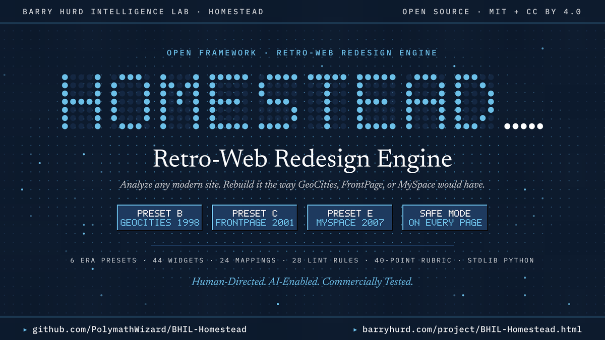

# Launch collateral

| File | Contents |
|---|---|
| [github-descriptions.md](github-descriptions.md) | Three repository descriptions at or under 350 characters, with a recommendation and topics |
| [linkedin-posts.md](linkedin-posts.md) | Technical authority, inquiry-driving, and peer builder variants, each closing with the BHIL tagline |
| [media/bhil-homestead-intro.gif](media/bhil-homestead-intro.gif) | Twelve-second seamless intro loop, 1200 x 675, about 1.4 MB, under LinkedIn's 5 MB GIF limit. Every frame carries the repository and project page addresses |
| [media/bhil-homestead-intro-poster.png](media/bhil-homestead-intro-poster.png) | The loop's first frame as a still, for link previews and slides |

## Addresses

| What | Where |
|---|---|
| Repository | https://github.com/PolymathWizard/BHIL-Homestead |
| Project page and scroll-through tour | https://barryhurd.com/project/BHIL-Homestead.html |
| Documentation site (GitHub Pages) | https://polymathwizard.github.io/BHIL-Homestead/ |

Attach the intro GIF to the LinkedIn variant you post, and set the project page as the repository's website in its About panel.

